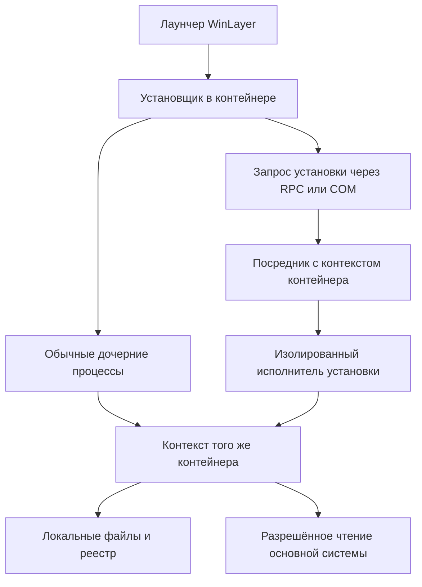

# Архитектура WinLayer для Windows

## Выбор основы

Выбран собственный гибридный движок: драйвер для файлов и реестра, нативные DLL x86/x64 и управляющая служба. Основной продукт разрабатывается на C#/.NET 10 с Avalonia. Ниже приведено сравнение подходов, а выбранный состав и начальные сценарии описаны [отдельно](13-Implementation-Options.md).

| Подход | Сильная сторона | Ограничение для проекта |
| --- | --- | --- |
| Sandboxie как изученный аналог | Уже решает значительную часть виртуализации файлов, реестра и служб | Не является основой выбранной собственной реализации |
| Перехват API внутри процесса | Удобен для узкого технического прототипа | Неполный охват вызовов и работы через внешние службы; нельзя считать доказательством локализации любой установки |
| Собственный драйвер и нативные компоненты — выбранный подход | Позволяет контролировать обращения глубже и задавать собственную семантику | Большой объём системного кода, требования к стабильности и сопровождению Windows |
| Виртуальная машина | Отдельная ОС может обслуживать свои службы и системные компоненты | Более тяжёлая среда; файловый образ и гостевая ОС меняют исходную модель обычной папки |

Sandboxie документирует собственную обработку RPC/DCOM, BITS и Windows Installer внутри песочницы. Это подтверждает необходимость слоя служб, но не является обещанием поддержки Visual Studio. [Service Programs](https://sandboxie-plus.github.io/sandboxie-docs/Content/ServicePrograms/).

Исходники Sandboxie доступны; перед включением кода или распространением компонентов нужно выбрать допустимую модель использования с учётом лицензий конкретных частей. [Репозиторий проекта](https://github.com/sandboxie-plus/Sandboxie).

## Компоненты собственной реализации

Прикладной стек выбран: C# и .NET 10, интерфейс — Avalonia последней стабильной версии. На 31 октября 2026 года последним стабильным выпуском является 12.1.4, что проверено по релизу проекта и опубликованным пакетам. При фактическом создании проекта нужно перепроверить версию, закрепить конкретный номер согласованных пакетов Avalonia и не использовать плавающую зависимость. [Релиз 12.1.4](https://github.com/AvaloniaUI/Avalonia/releases/tag/12.1.4), [Avalonia в NuGet](https://www.nuget.org/packages/Avalonia/12.1.4), [Avalonia.Desktop в NuGet](https://www.nuget.org/packages/Avalonia.Desktop/12.1.4).

Выбор Avalonia относится к интерфейсу; целевая виртуализация остаётся Windows-специфичной. Согласована граница: панель работает без постоянного повышения прав, управляющий компонент обслуживает жизненный цикл и проверяет команды, движок выполняет системное перенаправление. Служба и драйвер на хосте допустимы, инфраструктура устанавливается с необходимым повышением. Расчёты квот, конфигурация и прикладные операции не зависят от UI. Закрытие панели не должно прекращать работу контейнера. Конкретное распределение системных операций между драйвером и DLL определяется единым контрактом, чтобы не выполнять перенаправление дважды.

Предлагаемое разделение ответственности:

| Компонент | Назначение |
| --- | --- |
| Управляющее приложение на C# / .NET 10 / Avalonia | Создание среды, настройка правил, виртуальных дисков и квот, ярлыки, просмотр изменений, запуск установок и обновлений |
| Учёт места и правил доступа | Общий бюджет физического тома, лимиты виртуальных дисков, заявки на рост и исключения для рабочих папок |
| Посредник внешнего запуска и маршрутизатор URI | Разрешённые действия в приложениях хоста, возврат специальных ссылок в нужную среду и сопоставление поддержанных ответов авторизации |
| Локальная служба управления | Жизненный цикл контейнеров, подтверждённое повышение прав, взаимодействие с движком и восстановление состояния |
| Нативный компонент x64 и x86 | Поддержка виртуального представления в процессе и интеграция с выбранным механизмом перехвата |
| Файловый minifilter | Контроль и перенаправление файловых операций с учётом контекста контейнера |
| Фильтр реестра | Обработка обращений к реестру и формирование объединённого представления |
| Посредник служб | Локальные установки, обновления, регистрация и запуск поддерживаемых служб |
| Каталог приложений и действий | Учёт внутренних ярлыков, записей установки и доступных операций обслуживания |
| Издатель внешних элементов | Создание, обновление и очистка принадлежащих WinLayer ярлыков и записей программ на хосте |
| Интерфейс управления средой | Данные для панели контейнера и выполнение команд в правильном контексте |
| Хранилище контейнера | Файлы, локальные значения реестра, метки удаления, настройки и журнал восстановления |

Minifilter — официальный механизм фильтрации файлового ввода-вывода в ядре. Microsoft рекомендует его для новой разработки файловых фильтров. [File System Filter Drivers](https://learn.microsoft.com/en-us/windows-hardware/drivers/ifs/about-file-system-filter-drivers).

Реестр фильтруется отдельно: механизм уведомлений Configuration Manager позволяет блокировать, обрабатывать и перенаправлять операции. Он не создаёт готовый объединённый реестр автоматически. [Filtering Registry Calls](https://learn.microsoft.com/en-us/windows-hardware/drivers/kernel/filtering-registry-calls).

C# и .NET 10 выбраны для кода продукта, включая конфигурацию, управление, расчёт квот, маршрутизацию и интерфейс. .NET поддерживает вызовы нативных API и взаимодействие с компонентами через совместимый интерфейс. Это позволяет подключить системный механизм, но само по себе не перенаправляет обращения чужого EXE. Подмена `System.IO` или `Microsoft.Win32.Registry` только в управляющей программе эту задачу не решает. [Нативное взаимодействие .NET](https://learn.microsoft.com/en-us/dotnet/standard/native-interop/).

Собственный драйвер и нативные DLL входят в выбранный гибрид. Для этой части предлагается C/C++ с Windows SDK/WDK; основной прикладной код остаётся C#/.NET 10. Драйвер на целевом x64-хосте имеет разрядность x64, внутрипроцессные DLL выпускаются для x86 и x64. [Пример драйвера WDK](https://learn.microsoft.com/en-us/windows-hardware/drivers/gettingstarted/writing-a-very-small-kmdf--driver), [архитектуры и упаковка](13-Implementation-Options.md).

## Запуск и наследование среды

Опубликованный ярлык обращается к лаунчеру с идентификаторами контейнера и внутреннего действия. Лаунчер разрешает актуальную цель в среде: EXE с аргументами и рабочим каталогом, документ, URL либо поддерживаемое действие установки. Прямой запуск выбранного EXE также остаётся возможным через управляющий интерфейс. Идентификатор среды хранится в доверенном состоянии движка; переменная окружения может помогать диагностике, но не является достаточным основанием для назначения среды.

До выполнения кода запускаемого приложения должны быть установлены его правила доступа и перенаправления. В варианте с внедряемым компонентом это требует контролируемого запуска и ранней инициализации; наблюдение за уже работающим процессом оставляет окно для внешних записей. Одного `CREATE_SUSPENDED` без решения вопросов загрузки и внедрения недостаточно.

Правило по умолчанию: процесс, создаваемый процессом контейнера, получает тот же контейнер независимо от места хранения своего EXE. Например, запуск системного компилятора из IDE или установщика из внешней папки загрузок тоже требует соответствующего контекста. Исключение — явно разрешённое действие через посредника внешнего запуска, например открытие веб-ссылки в обычном браузере. Оно не превращает все процессы с таким именем в исключения. Идентичность процесса учитывает время жизни объекта процесса, а не только переиспользуемый PID.

Job Object полезен для учёта, ограничения ресурсов и завершения группы процессов. Обычные дочерние процессы могут включаться в него автоматически, но существуют исключения и механизмы выхода. Job Object не реализует файловое или реестровое перенаправление. [Job Objects](https://learn.microsoft.com/en-us/windows/win32/procthread/job-objects).

Нужно отдельно проверять запуск через оболочку, повышение UAC, COM, WMI, планировщик и службу. Перезапуск обновлённого установщика и продолжение после перезагрузки должны восстанавливать исходный контекст.

Передача действия уже работающему экземпляру приложения тоже соблюдает выбранный маршрут. В режиме изолированного браузера ссылка не должна уходить экземпляру хоста через механизм единственного экземпляра; в режиме внешнего браузера такая передача ожидаема. Возврат специальной ссылки из внешнего приложения требует маршрутизатора, поскольку наследования процесса здесь нет. Для поддерживаемых внутренних обработчиков нужны локальное состояние и контроль IPC. [Правила ярлыков](08-Host-Integration.md), [внешние приложения и протоколы](10-External-Applications-and-Protocols.md).

## Работа через системные службы

Условная схема показывает, почему одного родителя процесса мало:

Настоящий Service Control Manager является RPC-сервером и обслуживает общую базу служб. Если запрос передан ему без специальной обработки, запись может выполнять внешний процесс. Виртуализация файлов только у исходного установщика этого не исправляет. [Service control manager](https://learn.microsoft.com/en-us/windows/win32/services/service-control-manager).

Нельзя назначить общий `services.exe` или общий процесс службы одному контейнеру: он обслуживает другие приложения. Требуется поддерживаемый изолированный исполнитель либо посредник, сохраняющий контекст каждого запроса. Если такую операцию пока нельзя локализовать, она должна завершаться понятной ошибкой, а не исполняться на хосте для видимости успешной установки.

Повышение прав и принадлежность контейнеру — разные свойства. После UAC процесс не должен потерять контейнер. Реальные права администратора выдаются по обычному механизму Windows; имитация доступности виртуального `HKLM` не делает поддерживаемыми действия с реальными драйверами или компонентами ОС.

## Границы отдельных механизмов

`RegLoadAppKey` подходит как один из вариантов хранения локального куста. Он возвращает дескриптор частного куста, а не подключает автоматическое объединение с основным реестром. У него есть ограничения на дескрипторы безопасности внутри куста. [RegLoadAppKeyW](https://learn.microsoft.com/en-us/windows/win32/api/winreg/nf-winreg-regloadappkeyw).

`RegOverridePredefKey` меняет отображение предопределённого корня только в вызывающем процессе. Вызов в лаунчере не виртуализирует произвольного потомка и не добавляет чтение отсутствующих значений из основного реестра. [RegOverridePredefKey](https://learn.microsoft.com/en-us/windows/win32/api/winreg/nf-winreg-regoverridepredefkey).

Microsoft Detours позволяет инструментировать вызовы Windows API. Для прототипа это полезная основа, но из его назначения не следует полнота перехвата: прямые системные вызовы и запросы через неподконтрольные процессы требуют другого контроля. [Detours](https://github.com/microsoft/Detours).

ProjFS проецирует данные в файловое пространство. Из этого не следует подмена всех обращений к `C:\` только для выбранного дерева процессов; сам по себе он также не виртуализирует реестр. [ProjFS](https://learn.microsoft.com/en-us/windows/win32/projfs/projected-file-system).

AppContainer ограничивает доступ к ресурсам и может быть отдельным механизмом защиты. Готового универсального объединения файлов и реестра для любого установщика он не предоставляет. [AppContainer isolation](https://learn.microsoft.com/en-us/windows/win32/secauthz/appcontainer-isolation).

Существующая UAC-виртуализация реестра предназначена для ограниченных сценариев совместимости, отключена для 64-разрядных процессов и служб и не подходит как основа WinLayer. [Registry Virtualization](https://learn.microsoft.com/en-us/windows/win32/sysinfo/registry-virtualization).

## Требования к системному компоненту

В файловом пути обработки нужно учитывать повторный вход при обращении движка к собственной папке. Исключение для внутренних операций привязывается к доверенному контексту движка; общее правило «любой доступ к папке контейнера пропускать напрямую» создаёт обход политики.

Контекст контейнера должен сохраняться на объектах и операциях, где это требуется, включая отложенный и отображённый в память ввод-вывод. Проверки только текущего PID недостаточно для всех видов I/O.

Драйвер требует установки, подходящей подписи и проверки совместимости с целевыми версиями Windows. Требования подписи зависят от версии ОС и назначения сборки. [Kernel-Mode Code Signing Requirements](https://learn.microsoft.com/en-us/windows-hardware/drivers/install/kernel-mode-code-signing-requirements--windows-vista-and-later-).

Привилегированная служба принимает запросы только от разрешённых клиентов, проверяет принадлежность контейнера и нормализованные пути. Обработку критичных операций нельзя ставить в зависимость от живого окна интерфейса; сбой управления не должен переключать контейнер на внешнюю запись.
