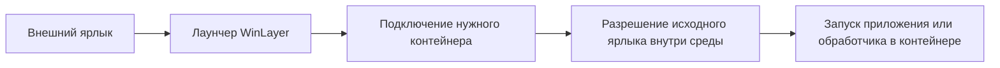

# Ярлыки и список программ основной системы

## Назначение

Приложения контейнера должны быть доступны с обычного рабочего стола, из меню «Пуск» и списка установленных программ Windows. Эти элементы выполняют нужное действие через WinLayer с учётом контейнера и выбранных исключений для внешних приложений.

Для этого предлагается отдельный слой публикации: внутри сохраняются исходные ярлыки и записи установки, снаружи WinLayer создаёт управляемые представления. Это явное исключение из правила локальной записи. Состав внешних объектов известен, их можно обновить или удалить при отключении контейнера.

Публикация не должна переносить наружу произвольные изменения реестра, регистрации COM или команды установщика. Внешний элемент содержит ссылку на действие WinLayer; фактическая команда разрешается внутри выбранной среды. Обычно она выполняется там же. Разрешённое внешнее действие, например открытие веб-ссылки обычным браузером, проходит через отдельного посредника; обратная URI-активация — через маршрутизатор. [Внешние приложения и протоколы](10-External-Applications-and-Protocols.md).

## Внешний ярлык

Отдельное согласованное требование — запуск произвольного поддержанного файла через контекстное меню Проводника. Команда «Запустить в контейнере…» выбирает среду и использует тот же механизм запуска, что панель и управляемые ярлыки. Для BAT/CMD внутри среды запускается интерпретатор; открытие внешним Shell без сохранения контекста не считается реализацией этого действия. EXE, скрипты, ярлыки и MSI имеют разные пути активации. [Типы файлов и варианты интеграции меню Windows 10/11](13-Implementation-Options.md).

Предлагаемая цепочка для обычного запуска в контейнере:

Оригинал остаётся по виртуальному пути, куда его создала программа. Внешний `.lnk` запускает установленный лаунчер WinLayer и передаёт ему идентификаторы контейнера и ярлыка. Это позволяет менять физическое расположение контейнера, путь внутреннего ярлыка и его содержимое без встраивания исходной команды в каждую внешнюю копию.

Хранится отдельная запись соответствия: идентификатор ярлыка, текущий виртуальный путь, происхождение, разрешённое место публикации и идентификатор внешнего объекта. При переименовании запись сохраняет идентичность. Замена ярлыка новым файлом по тому же логическому пути обрабатывается как обновление опубликованного действия, если связь подтверждена движком.

Лаунчер проверяет, что идентификаторы относятся к доступному контейнеру, читает актуальный оригинал и выполняет его действие через механизм запуска среды. Само наличие внешнего ярлыка не даёт права исполнять команду с повышением. Если оригинал исчез, контейнер отключён или действие не поддерживается, показывается причина; поиск похожего EXE на хосте с обычным запуском запрещён.

## Что сохранять из исходного ярлыка

Обычный `.lnk` может содержать цель, аргументы, рабочий каталог, режим окна, значок и описание. Кроме файлов, Shell Link может ссылаться на объекты пространства имён оболочки. Поэтому сведение ярлыка к одной строке пути теряет часть его смысла. [Shell Links](https://learn.microsoft.com/en-us/windows/win32/shell/links).

Исходный файл хранится целиком. Пути и переменные окружения разрешаются в контексте контейнера. При публикации можно перенести имя, описание и значок; действие всегда остаётся за лаунчером. Для значков, лежащих только внутри контейнера, нужен доступный хосту управляемый ресурс или кэш, который удаляется вместе с публикацией.

| Исходная цель | Ожидаемое действие |
| --- | --- |
| EXE с аргументами | Запуск с исходными аргументами и рабочим каталогом в контейнере |
| Документ | Выбор ассоциации в представлении контейнера и запуск обработчика в нём |
| Веб-ссылка или `.url` | Открытие в изолированном браузере либо в обычном внешнем браузере согласно явно выбранному режиму |
| Специальная URI-схема | Выбор обработчика и среды через маршрутизатор; для ответа авторизации — сопоставление с ожидающей операцией |
| Каталог | Открытие объединённого представления через файловый просмотрщик контейнера |
| MSI-ярлык установки по требованию | Разрешение и возможное восстановление через поддерживаемую контейнерную инфраструктуру MSI |
| Специальный объект оболочки или пакетное приложение | Отдельно поддержанный способ активации; иначе сообщение о неподдерживаемом действии |

`.url` имеет собственную модель Internet Shortcut и выбирает обработчик URL. Его простое копирование на настоящий рабочий стол приведёт к обычному открытию ссылки хостом. Снаружи и для такого оригинала нужен `.lnk` на WinLayer. [Internet Shortcuts](https://learn.microsoft.com/en-us/windows/win32/lwef/internet-shortcuts).

Некоторые MSI-ярлыки при активации проверяют установку компонентов и могут потребовать установочных действий. Их нельзя безопасно разбирать на хосте как обычный путь к EXE. [Shortcut Table](https://learn.microsoft.com/en-us/windows/win32/msi/shortcut-table).

Целевой контракт — сохранить смысл поддерживаемого ярлыка. Гарантия «любое содержимое без исключений» преждевременна: специальные активации, цепочки ярлыков и протоколы должны входить в матрицу совместимости. Циклические ссылки должны обнаруживаться.

## Браузер вне папки контейнера

Следующие разделы о копировании профиля относятся к режиму изолированного браузера. В режиме внешнего браузера работает его обычный экземпляр с настоящим профилем, а новые авторизации доступны без копирования. Этот вариант, загрузки и возврат специальных ссылок описаны [отдельно](10-External-Applications-and-Protocols.md).

Расположение EXE не определяет принадлежность процесса. Допустимо прочитать браузер из нижнего слоя и запустить его с правилами выбранного контейнера. Его изменяемые данные остаются локальными по общей политике среды.

Однако обычный вызов открытия ссылки не гарантирует создания нового процесса. Shell допускает передачу действия через DDE или другой механизм активации. [SHELLEXECUTEINFO](https://learn.microsoft.com/en-us/windows/win32/api/shellapi/ns-shellapi-shellexecuteinfow).

Пример механизма повторного использования экземпляра есть в исходниках Chromium: `ProcessSingleton` связывает экземпляры по каталогу данных и передаёт командную строку уже работающему процессу. Это пример конкретной реализации, а не универсальный контракт всех браузеров. [ProcessSingleton](https://chromium.googlesource.com/chromium/src/%2B/b26c92da0d902cf774bdb7c429beb129f6ec1f4d/chrome/browser/process_singleton.h).

В режиме изолированного браузера внешний профиль пользователя рассматривается как источник исходного состояния, чтобы по возможности сохранить существующие авторизации. Отдельным остаётся изменяемое состояние контейнерного экземпляра; оно не обязано начинаться с пустого профиля. Контроль межпроцессной передачи запросов сохраняется. Если браузер этого контейнера уже работает, передавать ссылку ему допустимо; передавать её экземпляру хоста или другого контейнера в этом режиме нельзя. Один дополнительный аргумент запуска не считается универсальным решением.

Выбор обработчика использует доступные ассоциации и настройки среды, не меняя браузер по умолчанию всей Windows. Для надёжного первого варианта можно явно выбрать поддерживаемый браузер для конкретного контейнера.

## Наследование внешнего профиля браузера

Пользовательская цель — открывать ссылки с привычным профилем и сохранять доступные действующие сеансы сайтов. Для изолированного браузера рассматриваются два режима: постоянная локальная копия на основе внешнего профиля и свежая внешняя основа на каждый новый сеанс браузера. Они являются альтернативами использованию обычного внешнего браузера; окончательный режим по умолчанию пока не выбран.

Это требует специальной обработки профиля. Обычное независимое копирование файлов при первой записи может смешать разные поколения связанных баз и журналов. После копирования базы cookies внутрь контейнера дальнейшие внешние изменения этой базы уже скрыты локальной версией; общего чтения нижнего слоя недостаточно для постоянной синхронизации входов.

Простой способ получения основы — подготовить согласованную локальную копию при закрытом внешнем браузере, затем использовать её независимо. Получение состояния работающего браузера требует отдельно проверенного способа для конкретного браузера; произвольное копирование открытых файлов не считается достаточным. Mozilla прямо требует закрыть Firefox при копировании данных между профилями. [Перенос данных Firefox](https://support.mozilla.org/en-US/kb/restore-bookmarks-passwords-and-data-from-an-old-firefox-profile).

Для одновременной работы у внешнего и контейнерного экземпляров должны быть независимые изменяемые хранилища, блокировки и область взаимодействия. Chromium описывает отдельные каталоги данных для параллельных экземпляров. Разрешать обоим браузерам напрямую изменять один физический профиль не предлагается. [Профили Chromium](https://www.chromium.org/developers/creating-and-using-profiles/).

В режиме постоянной локальной копии предлагается следующее поведение:

| Событие | Предлагаемое поведение |
| --- | --- |
| Первое использование браузера в среде | Получить согласованную основу из выбранного внешнего профиля и проверить совместимость |
| Повторное открытие ссылки | Использовать сохранённое локальное состояние или уже работающий экземпляр того же контейнера |
| Новый вход внутри контейнера | Сохранить новые данные локально для следующих запусков |
| Новый вход во внешнем браузере после создания основы | Не обещать автоматического появления внутри; обновление требует отдельного механизма согласования |
| Обновление основы из внешнего профиля | Выполнять при остановленном контейнерном браузере, с явным правилом сохранения или замены его локального состояния |
| Перенос среды на другой компьютер | Подключать профиль пользователя целевого компьютера; перенос авторизаций исходного компьютера не гарантируется |

Автоматическое объединение двух изменяющихся профилей не входит в простой файловый overlay. Оно затрагивает конфликты cookies, историю, расширения и связанные хранилища. В режиме постоянной копии обновление основы лучше сделать явной операцией, не выдавая её за непрерывную синхронизацию и не затирая локальные входы без ведома пользователя.

## Свежий внешний профиль на каждый сеанс

Этот режим соответствует сценарию, в котором внешний браузер служит основным местом работы, а контейнерный нужен для открытия ссылок с его текущими авторизациями. Перед новым сеансом WinLayer получает свежую согласованную основу и создаёт новый локальный слой записи только для профиля браузера. Предыдущий слой профиля не накладывается на новую основу. Остальные данные контейнера и загруженные за пределы временного профиля файлы сохраняются по своей обычной политике.

| Вариант | Новые входы из внешнего браузера | Изменения предыдущего контейнерного сеанса |
| --- | --- | --- |
| Постоянная локальная копия | Требуют отдельного обновления | Сохраняются |
| Свежая основа и новый слой записи | Подхватываются из полученного состояния при совместимости авторизаций | Не участвуют в новом сеансе |
| Свежая основа и прежний слой записи | Могут остаться скрыты прежними локальными базами | Сохраняются, но возможна несогласованная смесь состояний |

Например, во внешнем профиле появился вход на сайт Б, а локальная база cookies была создана до этого. Сохранение этой базы поверх нового внешнего снимка скроет вход на сайт Б. Файловый слой выбирает целый файл и не умеет объединять строки его базы. Замена базы свежей внешней версией, в свою очередь, теряет вход на сайт В, сделанный только внутри контейнера. Сохранить оба изменения автоматически можно лишь с отдельным механизмом, учитывающим формат и смысл данных браузера.

Сброс профиля затронет локальные cookies, настройки, историю, новые закладки, расширения и данные сайтов, которых нет во внешней основе. Даже без явных действий пользователя браузер обновляет служебное состояние. Можно временно хранить предыдущий сеанс для восстановления, но он не должен незаметно подмешиваться к новому. Удаление всего контейнера для обновления браузерного профиля недопустимо.

### Граница сеанса

«Каждый запуск» означает создание нового экземпляра браузера после завершения всех процессов, использующих его профиль. Открытие ещё одной ссылки или окна в существующем экземпляре относится к тому же сеансу. Фоновые процессы могут продолжать его после закрытия окон; смена основы допустима только после освобождения профиля.

В течение сеанса основа зафиксирована. Нельзя продолжать читать разные файлы прямо из меняющегося внешнего профиля и называть это снимком. Если пользователь вошёл на новый сайт снаружи уже после запуска контейнерного браузера, этот вход появится только при следующем обновлении основы. Замена баз под работающим экземпляром не поддерживается.

### Получение свежей основы

Открытый внешний браузер может удерживать файлы и изменять связанные хранилища во время чтения. В SQLite WAL является частью постоянного состояния базы: отделение базы от соответствующего журнала может потерять подтверждённые изменения или повредить копию. Поэтому недостаточно скопировать основной файл базы либо отдельно взять журнал позже. [SQLite Write-Ahead Logging](https://sqlite.org/wal.html#the_wal_file).

Согласованность одной базы не доказывает согласованности всего профиля. Нужен проверенный способ получения взаимосвязанного набора данных конкретного браузера. Дисковая копия также не содержит состояния, которое существует только в памяти и ещё не сохранено. Получение снимка файловой системы само по себе не гарантирует полноту прикладного состояния.

Для первоначального эксперимента надёжнее закрытый внешний браузер. Если ежедневный сценарий требует постоянно открытого внешнего браузера, получение пригодной основы без его закрытия становится отдельным критерием работоспособности. Ошибка получения свежего состояния не должна приводить к незаметному запуску пустого профиля или объявлению старой копии актуальной.

Новая основа подготавливается отдельно и подключается только после проверки готовности и освобождения старого сеанса. Не следует уничтожать последнюю рабочую копию до успешного получения следующей. Полное копирование большого профиля на каждый сеанс увеличивает задержку и расход диска; исключение кэшей и повторное использование неизменяемых данных допустимы только после проверки состава необходимых хранилищ.

### Сеансы сайтов и обновляемые токены

Свежий профиль не отменяет ограничения защиты авторизаций, описанные ниже. Кроме того, две копии одних и тех же данных входа не обязательно образуют независимые серверные сеансы.

Например, при ротации OAuth refresh token сервер выдаёт новый токен и делает предыдущий недействительным. Если конкретное приложение хранит такой токен в копируемых данных, обновление в контейнерной копии может оставить внешнюю копию со старым токеном; повторное использование также может вызвать отзыв сеанса. Это условный риск для соответствующих приложений, а не утверждение о поведении каждого сайта или любой cookie. [RFC 9700, раздел 4.14.2](https://www.rfc-editor.org/rfc/rfc9700.html#section-4.14.2).

Следовательно, режим свежей основы упрощает получение новых внешних входов, но не гарантирует отсутствие повторной авторизации. Особенно заметно это там, где нужный вход удаётся выполнить только внутри: если он не появился снаружи, следующий сеанс его не унаследует. Режим удобен для временного открытия ссылок; постоянная работа внутри браузера чаще требует сохранения его локального профиля.

## Совместимость авторизаций

Настройки, сохранённые пароли и действующие сеансы сайтов — разные данные. Наличие скопированного профиля не доказывает сохранение входа на каждом сайте. Например, Chrome использует App-Bound Encryption для защиты cookies: расшифровка проверяет идентичность приложения через привилегированную службу, а защита связана с компьютером. [Защита cookies Chrome](https://security.googleblog.com/2024/07/improving-security-of-chrome-cookies-on.html).

Поэтому целевой первый сценарий — тот же пользователь Windows, тот же компьютер и совместимая установленная версия браузера. Проверка должна включать штатную работу защиты данных в условиях контейнера. Само совпадение этих условий ещё не является гарантией; отключение защиты или подмена проверок не закладываются как способ поддержки профиля.

У поддерживающих DBSC сайтов продление сеанса может требовать ключа, связанного с устройством. Скопированных файлов cookies для такого продления недостаточно без доступности соответствующего штатного механизма. [Device Bound Session Credentials](https://developer.chrome.com/docs/web-platform/device-bound-session-credentials).

Если конкретный сеанс не удаётся использовать, браузер может потребовать обычный вход. В режиме постоянной копии полученное локальное состояние сохраняется между запусками; в режиме свежей основы оно относится только к текущему сеансу и не переносится в следующий автоматически. Требование формулируется как сохранение доступных авторизаций, а не гарантия бессрочного входа на любых сайтах: срок действия и отзыв сеанса определяет также сервер.

Даже при локальной записи профиля действия на сайте остаются внешними: выход с отзывом сеанса на сервере может затронуть и другую копию той же авторизации. Отсутствие изменений в файлах хоста не означает независимость аккаунтов на сервере.

Личный профиль подключается на компьютере конечного пользователя, независимо от подготовки программного образа на чистой Windows. Предлагается хранить такое состояние как персональный слой среды и исключать его из обычного экспорта образа ПО. Возможность перенести программу и возможность перенести её пользовательские авторизации рассматриваются отдельно.

## Где создавать внешние ярлыки

Предлагаемый режим по умолчанию — публиковать ярлыки, созданные в виртуальных папках рабочего стола и меню «Пуск», в соответствующие области текущего пользователя. Ярлыки из произвольного каталога остаются локальными, но доступны для ручной публикации через панель контейнера.

Расположение папок определяется через Known Folders, включая перенаправленные пользовательские каталоги, а не через жёстко заданный `C:\Users`. Публичные и пользовательские папки различаются. [KNOWNFOLDERID](https://learn.microsoft.com/en-us/windows/win32/shell/knownfolderid).

Для первой версии предлагается группа меню `WinLayer / <имя контейнера>` и отметка контейнера в имени внешнего ярлыка. При совпадении имён создаётся свободное имя; чужой файл не заменяется. Публикация для всех пользователей требует отдельной настройки и соответствующих прав, даже если установщик внутри был повышенным.

Автозагрузка, закрепление на панели задач и изменение глобальных ассоциаций не являются обычной публикацией ярлыков. Их следует оформлять отдельными возможностями. Создание ярлыка в виртуальной папке автозагрузки не должно неявно включать автозапуск на хосте.

## Перемещение и удаление ярлыков

Важна принадлежность объекта WinLayer, а не сходство имени или производитель приложения. Любая файловая операция сначала выполняется в виртуальном представлении; затем публикация согласуется с результатом.

| Действие внутри контейнера | Результат внутри | Что происходит снаружи |
| --- | --- | --- |
| Переименован или перемещён локальный ярлык между публикуемыми папками | Обычное виртуальное перемещение | Собственный внешний ярлык обновляется или перемещается в пределах разрешённых мест |
| Локальный ярлык перемещён в непубликуемый каталог | Ярлык остаётся по новому пути | Автоматическая публикация снимается; внутренний объект сохраняется |
| Ярлык скопирован в ещё одно публикуемое место | Появляется вторая логическая запись | Создаётся дополнительный внешний ярлык с отдельной идентичностью |
| Локальный ярлык удалён | Действует обычная семантика удаления слоя | Удаляется только соответствующий принадлежащий WinLayer внешний объект |
| Перемещён чужой ярлык из нижнего слоя | Создаётся локальный результат, исходный путь скрывается только внутри | Оригинал на хосте сохраняется; в разрешённом месте может появиться контейнерная версия |
| Изменён или удалён чужой ярлык | Локальное переопределение или метка удаления | Исходный ярлык хоста не изменяется |
| Назначение совпадает с чужим внешним ярлыком | Соблюдаются правила виртуального назначения | Для публикации выбирается другое имя; чужой объект не перезаписывается |

Обычная программа внутри контейнера не должна получать право переставлять настоящие ярлыки хоста лишь потому, что увидела их через нижний слой. Это сохраняет исходное обещание локальности изменений.

Если пользователь сам переместил внешний ярлык через Проводник, сохранённые идентификаторы позволяют ему продолжить запускать прежнее действие. Отслеживание нового внешнего пути и очистка таких копий — отдельная задача. WinLayer не должен искать и удалять произвольные похожие файлы по всему диску.

Удаление внешнего ярлыка пользователем не удаляет внутренний оригинал. Для известной публикации следует запомнить её отключение, чтобы фоновая синхронизация не создавала ярлык снова без конца. Если внешний файл изменён вручную и больше не соответствует управляемой записи, автоматическое перезаписывание и удаление прекращаются; состояние показывается как конфликт.

## Записи установленных программ

В обычных ветках удаления хранятся, среди прочего, отображаемое имя, версия, издатель, расположение, `UninstallString` и `ModifyPath`. [Uninstall Registry Key](https://learn.microsoft.com/en-us/windows/win32/msi/uninstall-registry-key).

WinLayer наблюдает за локальными изменениями поддерживаемых веток `Software\Microsoft\Windows\CurrentVersion\Uninstall` в пользовательском и машинном представлениях, включая применимые разрядности. Создание либо изменение записи формирует внутреннюю карточку приложения. Записи, только прочитанные из нижнего слоя, автоматически наружу не публикуются.

Если изменена унаследованная запись хоста, создаётся отдельная карточка с происхождением «локальное переопределение внешней записи». Её внешняя версия получает идентификатор WinLayer; исходная запись настоящего приложения не заменяется. Наличие такой карточки не доказывает, что все файлы продукта установлены локально.

Для внешней записи предлагается уникальный ключ вида `WinLayer.<ContainerId>.<ApplicationId>` в ветке удаления текущего пользователя. Локальная машинная установка может представляться пользовательской записью WinLayer на хосте: это независимые уровни. Название содержит имя контейнера, чтобы различать одинаковые программы в нескольких средах.

| Данные внешней записи | Предлагаемое поведение |
| --- | --- |
| Имя, версия и издатель | Берутся из текущей внутренней карточки; имя дополнено контейнером |
| Значок | Управляемый ресурс, доступный оболочке хоста |
| `UninstallString` | Вызов WinLayer с контейнером, приложением и действием удаления |
| `ModifyPath` | Вызов WinLayer для поддерживаемого изменения состава или интерфейса обслуживания |
| Тихое удаление | Публикуется только при известном поддерживаемом способе, выполняется через WinLayer |
| Размер | Оценка установщика либо измеренное значение с понятным происхождением; не сумма всего контейнера для каждой записи |
| Путь установки | Только корректно сопоставленный путь; недостоверное поле можно не публиковать |

Системная запись — представление продукта WinLayer, а не регистрация этого продукта в настоящей базе Windows Installer. Нельзя копировать исходный MSI ProductCode как идентичность хостовой установки, переносить `WindowsInstaller=1` или служебные ветки MSI так, чтобы Windows начала обслуживать контейнерный продукт своим внешним установщиком.

Отображение и доступность кнопок зависят от Windows и типа записи; стандартные свойства MSI позволяют управлять доступностью удаления, изменения и восстановления. Произвольная внешняя запись не гарантирует отдельную кнопку «Исправить» во всех интерфейсах Windows. Полный набор доступных операций предоставляется в панели WinLayer. [Configuring Add/Remove Programs](https://learn.microsoft.com/en-us/windows/win32/msi/configuring-add-remove-programs-with-windows-installer).

Скрытые служебные пакеты и записи без пригодных действий не нужно превращать в обычные пользовательские приложения. Их можно показать в расширенном списке панели. Поддержка MSIX, собственной базы установщика и продуктов без стандартной записи удаления требует отдельных источников каталога; один просмотр ветки реестра не является полным инвентаризатором Windows.

## Удаление и исправление через внешний список

При выборе удаления Windows вызывает WinLayer. Он подключает контейнер, проверяет актуальную карточку, получает исходное действие внутри среды и запускает его с тем же контекстом, включая потомков, службы и повышение прав. Исходная команда не выполняется привилегированным издателем на хосте.

Для MSI исходная команда должна достигать поддерживаемого контейнерного механизма MSI. Простое добавление префикса перед внешним `msiexec` не решает виртуализацию его служб и базы продуктов.

Отмена, ошибка, перезагрузка и продолжение обслуживания сохраняются как состояния операции. Внешняя запись удаляется после подтверждённого завершения и согласования внутреннего каталога, а не сразу после старта деинсталлятора. Если исходная регистрация исчезла в середине операции, публикация удерживается до её завершения или восстановления состояния.

Исправление доступно только при наличии известного действия установщика. Нельзя выводить универсальную команду ремонта из названия приложения или механически менять флаги любой строки удаления. Одновременно выполняющиеся конфликтующие операции обслуживания одного контейнера должны координироваться.

## Согласование публикаций

Сохранение ярлыка или записи реестра может происходить по частям. Нужен процесс согласования, который получает события движка, читает завершённое доступное состояние и периодически сверяет его с каталогом. Простой файловый наблюдатель не видит все необходимые события реестра и не гарантирует отсутствие пропусков.

При сбое издателя установка остаётся в контейнере; неподтверждённая публикация повторяется без создания дублей. Подготовленные внешние объекты публикуются согласованно, насколько позволяет их формат. Изменения регистрационных полей не должны запускать записанные команды во время наблюдения.

Для предотвращения обратной связи служебные записи и ярлыки WinLayer исключаются из нижнего представления для автоматического импорта. Каталог различает локальные оригиналы и свои внешние публикации; повторное оборачивание уже опубликованного ярлыка не допускается.

Отключение контейнера снимает его управляемые публикации, сохраняя данные. Перенос обновляет привязку идентификатора к папке; независимая копия получает новый идентификатор. Временная недоступность диска не означает удаление контейнера: запуск сообщает о недоступности. После ручного удаления папки остаётся возможность убрать известные внешние записи без запуска исходного деинсталлятора.

## Оценка сложности

| Часть | Относительная сложность при работающем движке |
| --- | --- |
| Обычный внешний `.lnk` на лаунчер | Низкая |
| Надёжное обновление, перемещение и очистка своих публикаций | Средняя |
| Отображение приложения в списке Windows и передача команды в контейнер | Средняя |
| Обычное удаление через уже поддерживаемый установщик | Зависит прежде всего от готовности движка установки |
| Открытие веб-ссылки обычным внешним браузером | Умеренная при готовом посреднике; копирование профиля не требуется |
| Изолированные браузеры и приложения с одним экземпляром | Высокая из-за профилей, ассоциаций и IPC |
| Специальные схемы и возврат авторизации в несколько копий приложения | От средней для обычных ссылок до высокой для закрытых протоколов и параллельных входов |
| MSI-ярлыки, ремонт, UAC и служебная активация | Высокая; это продолжение сложной части виртуализации установщиков |

Сам интерфейс публикации заметно проще полноценной виртуализации Visual Studio. Основной риск — гарантировать, что конечное действие после всех посредников соответствует выбранной политике, а обслуживание и поддержанные ответы авторизации попадают в нужную среду.
