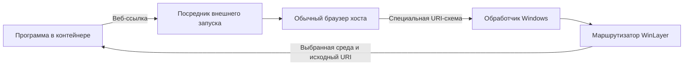

# Внешние приложения и специальные ссылки

## Задача и предлагаемый режим

Для цели «держать установку ПО в одной папке» предлагается разрешить открытие веб-ссылок обычным браузером хоста. Он использует настоящий профиль пользователя, существующие авторизации и внешнюю папку загрузок. Копирование профиля, согласование его баз и перенос защищённых cookies для этого режима не нужны. Это предложение по настройке, а не уже реализованная возможность или окончательно выбранный режим по умолчанию.

Браузер действительно работает снаружи: меняет свой профиль, историю и загрузки. Эти изменения не входят в контейнер и не удаляются вместе с ним. Установка и обслуживание самого контейнерного приложения по-прежнему должны оставаться внутри. Изолированный браузер с отдельным состоянием остаётся альтернативой; его сложности описаны в [правилах интеграции](08-Host-Integration.md).

## Исключение относится к действию

Предлагается правило «открывать HTTP/HTTPS-ссылки во внешнем браузере через посредник WinLayer». Простое правило «любой процесс с именем chrome.exe запускается снаружи» слишком широко: у программы есть другие режимы работы и произвольные аргументы запуска.

Посредник получает тип действия, URI и подтверждённый движком контекст отправителя. Внешнее открытие выполняется с обычными правами текущего пользователя и с выбранным обработчиком хоста. Нельзя переносить наружу произвольную командную строку, повышение прав, рабочий каталог, окружение или наследуемые дескрипторы процесса контейнера. Прямой запуск браузера с аргументами требует отдельно поддержанного адаптера; встроенный WebView не становится внешним браузером автоматически.

Обычные запуски EXE и дочерние процессы сохраняют контейнер. Внешний браузер и его собственные потомки принадлежат хосту; возвращение из него в контейнер — отдельная операция маршрутизатора. Подобные исключения для других программ задаются отдельно, с указанием разрешённых действий и последствий для внешних данных.

## Скачанные файлы

Контекст определяется операцией запуска, а не местом хранения или происхождением файла.

| Действие | Ожидаемое поведение |
| --- | --- |
| Внешний браузер скачал файл | Файл появился в настоящей папке загрузок пользователя |
| Контейнерная программа читает этот путь | Читает внешний файл через нижний слой, если путь не перекрыт локальной версией или меткой удаления |
| Контейнерная программа меняет файл | Создаёт и меняет локальную версию; внешний оригинал сохраняется |
| Контейнерная программа запускает скачанный EXE | Новый процесс получает тот же контейнер, хотя EXE расположен снаружи |
| Контейнерная программа открывает документ через ассоциацию | Обработчик работает внутри, кроме явно разрешённого внешнего действия |
| Пользователь нажал «Открыть» во внешнем браузере или в Проводнике | Обычный внешний запуск; автоматического возвращения в контейнер нет |
| Пользователь выбрал действие WinLayer «Запустить в контейнере…» | Явный запуск файла в выбранной среде |

Если локальная копия уже появилась, новая внешняя версия файла не заменяет её автоматически. Путь загрузок определяется настройками пользователя, а не жёстко заданным `C:\Users\...\Downloads`. Запуск скачанного установщика через UAC, MSI или службу требует сохранения контекста на тех же основаниях, что и любая другая установка.

Общий браузер может обслуживать несколько контейнеров и обычные вкладки одновременно. По одной папке загрузок нельзя надёжно определить контейнер назначения. Автоматическая привязка загрузок к запросившей программе потребовала бы отдельной интеграции с браузером и не входит в базовый режим.

## Специальные URI-схемы

Ссылки вида `magnet:?xt=...` и `myapp://open?...` относятся к именованным URI-схемам. Обработчик регистрируется в Windows; выбранное приложение получает активацию с URI. Microsoft отдельно описывает регистрацию для упакованных и обычных настольных приложений. [Обработка URI в Windows](https://learn.microsoft.com/en-us/windows/apps/develop/launch/handle-uri-activation), [вариант для .NET](https://learn.microsoft.com/en-us/windows/apps/develop/launch/handle-uri-activation-dotnet).

Для WinLayer предлагается такая цепочка:

Цепочка действует, когда Windows направляет данную схему в WinLayer. Внутренняя регистрация обработчика сама по себе не делает его доступным внешнему браузеру.

При появлении регистрации в локальном реестре WinLayer добавляет её в каталог контейнерных обработчиков. Внешняя управляемая регистрация, если включена публикация этой схемы, указывает на маршрутизатор WinLayer. Команда приложения остаётся внутри контейнера; напрямую копировать её в реестр хоста нельзя. Ссылка может прийти из браузера, другого приложения или ярлыка — правила одинаковы.

Минимальная запись каталога содержит схему, идентификаторы контейнера и приложения, способ активации, ссылку на внутреннюю регистрацию и сведения о своей внешней публикации. Физический путь папки разрешается при запуске. Служебная регистрация WinLayer не должна повторно импортироваться из нижнего слоя как новый обработчик.

## Несколько обработчиков одной схемы

Windows выбирает приложение по умолчанию для типа ссылки; это не отдельный выбор для каждого контейнера. Пользователь может менять сопоставления протоколов в настройках Windows. [Приложения по умолчанию](https://support.microsoft.com/en-us/windows/apps/change-default-apps-in-windows).

Поэтому маршрутизатор должен учитывать несколько контейнерных обработчиков и уже установленный обработчик хоста. Предлагаемые правила:

1. Для обычной ссылки применяется сохранённое назначение либо показывается выбор приложения и среды. Настройка может оставлять `magnet:` внешнему торрент-клиенту или направлять его в конкретный контейнер.
2. Внутренний запрос уже содержит контекст среды: предпочтителен её обработчик, если явно не выбрано внешнее исключение.
3. Внешняя ссылка обычно не содержит идентификатора контейнера. Нельзя восстанавливать его по последнему активному окну или PID браузера.
4. Регистрация кандидата и выбор обработчика по умолчанию — разные действия. WinLayer использует поддерживаемые Windows способы регистрации и выбора; существующий пользовательский выбор не подменяется незаметно.
5. После выбора контейнера исходный обработчик запускается в нём либо получает активацию через поддерживаемый внутренний IPC. Наличие внешнего экземпляра той же программы не даёт основания передать запрос ему.

Если маршрутизатор передаёт обычную ссылку сохранённому обработчику хоста, он должен адресовать именно его поддержанным способом. Повторный общий вызов открытия той же схемы может снова вызвать WinLayer и создать цикл. Неподдерживаемая форма активации показывается как ограничение совместимости.

## Возврат авторизации

При стандартном OAuth-входе через браузер приложение получает ответ авторизации, например одноразовый код, и обменивает его на собственные токены. Cookies браузера для этого переносить в контейнер не требуется. Внешний браузер может использовать уже существующий вход на сайте; сайт всё же может запросить подтверждение. Варианты возврата включают специальную URI-схему, локальный HTTP-адрес и поддержанные платформой HTTPS-ссылки приложения. [RFC 8252, разделы 4 и 7](https://www.rfc-editor.org/rfc/rfc8252.html).

Для примера можно представить `com.example.client:/signin?code=...&state=...`. Это условная схема, не утверждение о протоколе Epic Games. Конкретный способ входа существующей программы проверяется отдельно.

Для поддержанных приложений WinLayer хранит краткоживущую запись ожидаемого ответа: контейнер, приложение, ожидаемый адрес возврата, доступный признак сопоставления запроса и ответа, срок ожидания и состояние доставки. Если адаптер видит `state` в исходном запросе, его можно использовать для маршрутизации, не подменяя проверку в самом приложении. Проверки `state`, адреса возврата и PKCE остаются частью штатного протокола приложения. [RFC 8252, разделы 6 и 8.9](https://www.rfc-editor.org/rfc/rfc8252.html#section-8.9).

Предлагаемый контракт доставки:

- Ответ направляется только в однозначно сопоставленный экземпляр приложения. Одно совпадение имени схемы недостаточно для двух параллельных входов.
- Неизвестный, просроченный или неоднозначный ответ не отправляется случайному контейнеру и не передаётся обработчику хоста по запасному правилу. Пользователь получает понятное сообщение с предложением повторить вход в выбранной среде.
- Если приложение не предоставляет наблюдаемого признака сопоставления, универсальная прозрачная маршрутизация не обещается. Нужен адаптер либо явно ограниченный сценарий с одним адресатом и проверкой ответа самим приложением.
- WinLayer не меняет `redirect_uri`, параметры ответа или идентичность OAuth-клиента ради добавления идентификатора контейнера.
- Полные адреса авторизации, коды и токены не сохраняются в диагностических журналах. Учитываются повторная доставка, отмена, остановка контейнера и завершение ожидающего процесса; доставка не равнозначна успешному входу.

Не каждую ссылку с параметром `code` можно автоматически считать возвратом входа. Отличие между обычной ссылкой и ответом авторизации задаётся ожидающей операцией и адаптером приложения. При отсутствии такого знания применяется явно ограниченная поддержка, а не обещание распознать любой протокол.

## Другие способы возврата

Для возврата через `http://127.0.0.1:<порт>/...` браузер обращается к локальному слушателю приложения. При общем сетевом пространстве и разрешённом доступе это может работать без регистрации URI-схемы. Нужна проверка выбранного движка, правил сети и конфликта портов у параллельных экземпляров. Автоматически заменить фиксированный порт у произвольной программы нельзя.

Связанные с приложением HTTPS-ссылки и пакетная активация требуют отдельной поддержки модели Windows. Регистрация произвольной схемы не заменяет её, а перехватывать все HTTPS-ссылки хоста для этого не предлагается. Если приложение получает результат через серверный опрос, обратного запуска из браузера может вовсе не быть; этот сценарий также проверяется отдельно.

## Передача URI и жизненный цикл

Маршрутизатор проверяет разрешённую схему, размер и формат запроса, доступность адресата и действие. Не следует требовать `://`: допустимая форма зависит от схемы. Исходный URI сохраняется без повторного декодирования, перестановки параметров и потери фрагмента. Способ передачи должен сохранить его как одно значение, с корректным экранированием для поддержанного обработчика. Запуск через сборку строк для `cmd` или PowerShell не используется. Неизвестные шаблоны команд и нестандартные механизмы активации требуют отдельной поддержки.

Обновление приложения обновляет внутренний адресат. Удаление контейнера снимает его маршруты и только принадлежащие WinLayer внешние регистрации. Общий маршрутизатор сохраняется, пока нужен другим контейнерам. Если пользователь уже изменил системную ассоциацию, WinLayer не затирает её старой сохранённой настройкой; восстановление прежнего выбора при необходимости выполняется поддерживаемым Windows способом. Обычные подтверждения браузера на открытие внешнего приложения не обходятся.

В панели видны направления для схем, обработчики хоста, ожидающие операции без секретных параметров и причины ошибок. Внешний браузер не входит в список процессов контейнера и не завершается при его остановке. Связь с запросом контейнера можно показывать отдельно.

## Проверки перед заявлением поддержки

| Сценарий | Критерий |
| --- | --- |
| Внешний браузер уже работает | Открывается его вкладка с обычным профилем, копия профиля не создаётся |
| Чтение и запуск внешней загрузки из контейнера | Чтение следует правилам слоёв; процесс и его установочные действия остаются внутри |
| Открытие загрузки из внешнего браузера | Зафиксирован внешний запуск; действие WinLayer позволяет явно выбрать контейнер |
| Обычная ссылка при двух контейнерах и внешней установке | Применяется выбранный маршрут без захвата чужой ассоциации и рекурсии |
| Два одновременных входа через одну схему | Ответы однозначно сопоставлены либо сценарий явно признан неподдерживаемым |
| Ошибочный, повторный и просроченный ответ | Нет передачи кода другому приложению; причина доступна без секретных параметров |
| Обработчик уже работает | Активация попадает в экземпляр выбранной среды |
| URI с экранированием, Unicode, фрагментом и без двойного слеша | Содержание не повреждено и не превращается в дополнительные аргументы |
| Возврат по локальному HTTP | Проверены доступность слушателя, конфликт портов и остановка приложения |
| Удаление, перенос и изменение ассоциации пользователем | Свои маршруты согласованы, чужие настройки и внешние данные сохранены |

Обычное открытие внешнего браузера и запуск EXE из загрузок относительно просты при готовом движке. Универсальная обратная активация, несколько копий одного клиента и закрытые протоколы авторизации — отдельная существенная часть совместимости.
