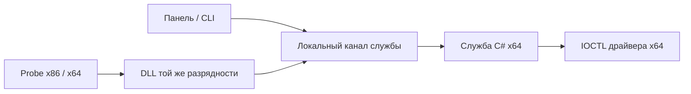

# Диагностический прототип

Работа относится к [задаче #1](https://github.com/makkoar/WinLayer/issues/1). Это первая связка компонентов, а не рабочая песочница: перенаправление файлов и реестра, инъекция DLL, назначение контекста процессов и установка прикладного ПО ещё не реализованы.

## Состав решения

| Проект | Назначение |
| --- | --- |
| `WinLayer.Contracts` | Двоичный протокол запросов и ответов |
| `WinLayer.Client` | Асинхронный клиент локального канала службы |
| `WinLayer.Service` | Windows-служба с консольным режимом, канал и вызов IOCTL |
| `WinLayer.App` | Минимальная панель Avalonia 12.1.4 для проверки связи |
| `WinLayer.Cli` | Консольная диагностика |
| `WinLayer.Driver` | Исходники управляющего драйвера x64 |
| `WinLayer.Runtime` | Исходники DLL x86/x64 для обращения к службе |
| `WinLayer.Probe` | Нативный клиент, вызывающий DLL своей разрядности |
| `Native.Shared` | Общий нативный заголовок ABI |
| `Tests/WinLayer.Tests` | Автоматические проверки и покрытие всей C#-части |

`WinLayer.slnx` содержит управляемые проекты. `WinLayer.Native.slnx` — нативные; конфигурация Win32 не собирает драйвер, x64 собирает все три проекта.

## Путь запроса



DLL не выполняет работу в `DllMain` и пока не внедряется в чужие процессы. `WinLayerQuery` явно вызывается диагностическим клиентом. Возврат `ERROR_SUCCESS` означает корректный транспортный ответ; доступность драйвера определяется полем `Status`.

Драйвер создаёт `\\.\WinLayerControl` через `IoCreateDeviceSecure`. Прямой доступ разрешён SYSTEM и администраторам. Доступно только получение сведений: команд запуска, записи или назначения контекста нет. Это управляющий WDM-драйвер, а не готовый minifilter. Файловая и реестровая фильтрация относятся к [#4](https://github.com/makkoar/WinLayer/issues/4) и [#5](https://github.com/makkoar/WinLayer/issues/5).

Канал `WinLayer.Control.v1` предоставляет чтение/запись аутентифицированным локальным пользователям; сетевой вход запрещён ACL. Служба использует один серверный экземпляр и обрабатывает один запрос на соединение. Если клиент оборвал соединение ещё до завершения подключения, служба пересоздаёт повреждённый экземпляр канала. Ожидание запроса клиента ограничено двумя секундами, общий предел клиента — три секунды. После ответа сервер ждёт закрытия клиента, чтобы не отбросить непрочитанные данные.

Диагностическая ACL не является готовой моделью авторизации управления. Перед добавлением команд нужны проверки пользователя, контейнера и полномочий конкретной операции.

## Двоичный контракт версии 1

Поля — беззнаковые 32-битные числа little-endian. Запрос занимает 16 байт, ответ — 32; размер не зависит от разрядности клиента. Нативные размеры проверяются при компиляции, C# — фиксированными байтовыми эталонами.

| Смещение | Запрос | Ответ |
| --- | --- | --- |
| 0 | Magic: `0x31594C57` | Magic: `0x31594C57` |
| 4 | Version: `1` | Version: `1` |
| 8 | Size: `16` | Size: `32` |
| 12 | Operation: `1` | Status |
| 16 | — | DriverVersion |
| 20 | — | Capabilities |
| 24 | — | Architecture |
| 28 | — | NativeError |

IOCTL: `0x80006000` (`DeviceType=0x8000`, `Function=0x800`, `METHOD_BUFFERED`, `FILE_READ_DATA`). Драйвер копирует запрос до записи ответа в общий системный буфер.

Результаты: `0` — ответ драйвера, `1` — повреждённый запрос, `2` — неподдерживаемая версия/операция, `3` — драйвер недоступен, `4` — несовместимый ответ драйвера, `5` — внутренняя ошибка. При успехе текущий драйвер сообщает версию `1`, возможность `1` (диагностика) и архитектуру `64`. При ошибке сведения о драйвере нулевые; `NativeError` может содержать код Windows. Успех не означает изоляцию приложения.

## Сборка и запуск C#

Требуются Windows x64, SDK ветки .NET 10.0 и PowerShell 7. Версии пакетов закреплены в `Directory.Packages.props`. [Правила разработки](../CONTRIBUTING.md).

```powershell
dotnet build WinLayer.slnx -c Debug
dotnet test --project Tests/WinLayer.Tests/WinLayer.Tests.csproj -c Debug
dotnet run --project WinLayer.Service --no-build
```

Последняя команда запускает консольную службу без регистрации в SCM. В другом терминале:

```powershell
dotnet run --project WinLayer.Cli --no-build
dotnet run --project WinLayer.App --no-build
```

Без драйвера ожидается `DriverUnavailable` и код Windows `2`. Без службы клиент завершает ожидание; CLI возвращает `1`. При ответившей службе и недоступном драйвере CLI возвращает `2`; при ответе драйвера — `0`. Для доступа к драйверу консольная служба на стенде запускается с повышением; установленная служба использует SYSTEM.

Для панели создан штатный профиль Visual Studio `FolderProfile`: Release, framework-dependent SingleFile `win-x64`, без ReadyToRun и trimming, каталог `bin/publish`. Требуется установленный .NET 10; нативные зависимости могут находиться рядом. Настройки находятся в `WinLayer.App/Properties/PublishProfiles/FolderProfile.pubxml` и доступны в окне публикации Visual Studio. Команда CLI:

```powershell
dotnet publish WinLayer.App/WinLayer.App.csproj -c Release -p:PublishProfile=FolderProfile
```

Публикация вызывает проверку 100% покрытия всех C#-сборок и останавливается при недостижении порога. Пакеты инструментов SingleFile подключает SDK; отдельные ссылки на них в проектах не добавлены.

## Нативная сборка и стенд

Из Developer PowerShell Visual Studio 2026 с инструментами и согласованной парой SDK/WDK, указанными в [требованиях к среде](../CONTRIBUTING.md#среда-разработки):

```powershell
msbuild WinLayer.Native.slnx /t:Build /p:Configuration=Debug /p:Platform=x64
msbuild WinLayer.Native.slnx /t:Build /p:Configuration=Debug /p:Platform=Win32
msbuild WinLayer.Native.slnx /t:Build /p:Configuration=Release /p:Platform=x64
msbuild WinLayer.Native.slnx /t:Build /p:Configuration=Release /p:Platform=Win32
```

Результаты: `artifacts/native/<платформа>/<конфигурация>`. Для каждого `WinLayer.Probe.exe` рядом нужна DLL той же разрядности. Драйвер собирается без автоматической подписи; ключи и сертификаты не включаются в проект.

На отдельной Windows с возможностью отката подготовьте тестовую подпись по документации Microsoft. Скопируйте подписанный драйвер и результаты управляемой сборки с зависимостями. Следующие команды предназначены только для повышенного терминала тестовой системы; путь приведён как пример:

```powershell
sc.exe create WinLayerDriver type= kernel start= demand binPath= C:\WinLayerTest\WinLayer.Driver.sys
sc.exe start WinLayerDriver
```

Запустите консольную службу с повышением, затем CLI и оба нативных клиента без повышения. Ожидается одинаковый ответ драйвера x64 при разной разрядности DLL. Остановите службу и проверьте выгрузку:

```powershell
sc.exe stop WinLayerDriver
sc.exe delete WinLayerDriver
```

Для режима SCM поддерживается имя службы `WinLayer` через `AddWindowsService`. Установщик и восстановление после обновлений — [задача #7](https://github.com/makkoar/WinLayer/issues/7). Наличие инструкции не означает, что установка уже проверена.

## Проверенное состояние

Управляемое решение собрано без предупреждений. Все 50 тестов проходят; в Debug и Release достигнуто 100% строк, ветвей и методов в каждой из пяти продуктовых сборок: Contracts, Client, Service, CLI и App. Строгая проверка покрытия выполнена без исключения панели, точек входа или системных адаптеров. Публикация `FolderProfile` проходит с включённым порогом и создаёт SingleFile-приложение.

Автоматически проверены ABI, несовместимые сообщения, повторные подключения, запрос по частям, отмена, ранний обрыв и восстановление после таймаута, ACL канала, запуск и остановка хоста, коды CLI, жизненный цикл панели и состояния кнопки. Отдельный тест воспроизводит обрыв до приёма подключения: сервер освобождает повреждённый экземпляр вместо бесконечного повторения ошибки.

Разбор успешных и ошибочных ответов драйвера проверяется через подменяемый системный канал. Настоящие вызовы Win32 проверены на отсутствующем устройстве и неподдерживаемом IOCTL обычного файла. Это не заменяет проверку успешного IOCTL загруженного драйвера.

DLL и Probe собраны без предупреждений для Win32 и x64 в Debug и Release с Visual Studio 2026 Insiders 18.12, MSVC 14.52 (v145) и SDK 28000. Проверены архитектуры PE и экспорт `WinLayerQuery`. Все четыре нативных клиента обратились к настоящей консольной службе и получили ожидаемый `DriverUnavailable`, код Windows `2` и код завершения `2` без установленного драйвера.

Установлены C++-инструменты, SDK 28000, WDK 28000.2526 и интеграция WDK в Visual Studio. Полная пересборка нативного решения прошла во всех четырёх конфигурациях без предупреждений и ошибок; Win32 собирает DLL и Probe, x64 дополнительно собирает драйвер. Проверены формат драйвера PE x64, подсистема Native и точка входа `GsDriverEntry`. Драйверы Debug и Release находятся в `artifacts/native/x64/<конфигурация>/WinLayer.Driver.sys`.

Драйвер собран без подписи и не загружался в рабочую систему. Подпись, загрузка/выгрузка, успешный полный канал, доступ отдельной обычной учётной записи и матрица Windows 10/11 требуют стенда.

## Источники

- [Служба Windows на .NET](https://learn.microsoft.com/en-us/dotnet/core/extensions/windows-service).
- [IoCreateDeviceSecure](https://learn.microsoft.com/en-us/windows-hardware/drivers/ddi/wdmsec/nf-wdmsec-wdmlibiocreatedevicesecure).
- [Определение IOCTL](https://learn.microsoft.com/en-us/windows-hardware/drivers/kernel/defining-i-o-control-codes).
- [Тестовая подпись драйвера](https://learn.microsoft.com/en-us/windows-hardware/drivers/install/installing-a-test-signed-driver-package-on-the-test-computer).
- [Интеграция Coverlet с Microsoft.Testing.Platform](https://github.com/coverlet-coverage/coverlet/blob/master/Documentation/Coverlet.MTP.Integration.md).
- [xUnit v3 4.0.2](https://xunit.net/releases/v3/4.0.2).
